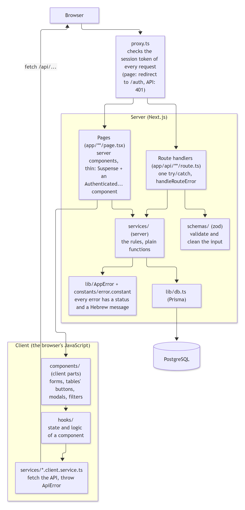
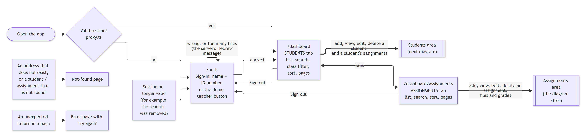
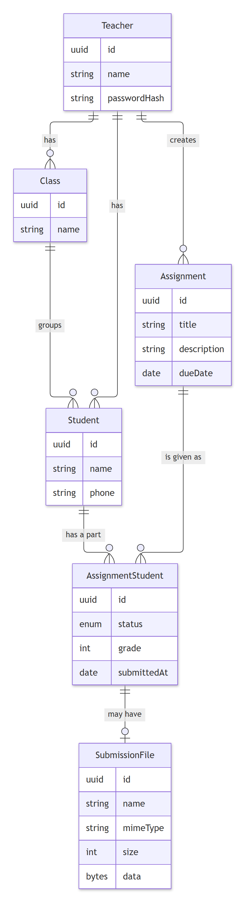

# Teacher Buddy

A small web app for teachers to manage their students, give assignments, collect the checked work and record grades. The interface is in Hebrew (right-to-left) and follows the system light or dark theme.

> Built as a home assignment. [Assignment brief](./docs/assignment.pdf)

**Live demo:** https://teacher-buddy-tau.vercel.app/

## Contents

1. [Tech stack](#tech-stack)
2. [Run it locally](#run-it-locally)
3. [How to use the app](#how-to-use-the-app)
4. [Architecture](#architecture)
5. [Testing](#testing)
6. [Deployment](#deployment)
7. [Known limits](#known-limits)

---

## Tech stack

### Main technologies

| Area | Technology | Why it is used |
|---|---|---|
| Framework | **Next.js 16** (App Router) | One project for the pages and the API. Server components load the data, and `proxy.ts` guards every route |
| UI | **React 19**, **TypeScript** | Components and type safety across the whole project |
| Styling | **Tailwind CSS 4** | Fast styling, with built-in dark mode and right-to-left support |
| Database | **PostgreSQL** | Relational data: teachers, classes, students, assignments |
| ORM | **Prisma 7** | Typed queries and versioned migrations |
| Validation | **zod 4** | One schema per request, with Hebrew error messages per field |
| Auth | **jose** and **Argon2** | A signed session cookie (JWT), and the ID number is stored only as a hash |
| Rich text | **Tiptap** | The editor for the assignment description |
| Tests | **Vitest** and **Playwright** | Unit tests, and real-browser tests of the full flows |

### Main dependencies

| Package | Purpose |
|---|---|
| `next`, `react`, `react-dom` | The framework and the UI library |
| `@prisma/client`, `@prisma/adapter-pg`, `pg` | The database client. The adapter connects Prisma 7 to PostgreSQL through the `pg` driver |
| `prisma` (dev) | The CLI for migrations and the generated client |
| `zod` | Validates every request body, and the filters in the address of the lists |
| `jose` | Signs and verifies the session token (JWT) |
| `@node-rs/argon2` | Hashes the teacher's ID number, which is the password |
| `@tiptap/react`, `@tiptap/starter-kit`, `@tiptap/pm` | The rich text editor (headings, bold, italic, lists) |
| `sanitize-html` | Cleans the description on the server, so only the formats the editor offers are saved |
| `server-only` | Makes the build fail if server code is imported by the browser |
| `dotenv` | Loads `.env` for the scripts and the Prisma CLI |
| `tailwindcss`, `@tailwindcss/turbopack` (dev) | Styling |
| `vitest`, `@playwright/test` (dev) | Unit and end-to-end tests |
| `tsx`, `eslint`, `typescript` (dev) | Running scripts, linting and type checking |

### Hosting

 Vercel for the app, and a hosted PostgreSQL (Supabase) for the data.

---

## Run it locally

### Requirements

- Node.js 22 or newer
- A PostgreSQL 15+ database: a local one, or a hosted one (Supabase, Neon and similar)

### Steps

```bash
# 1. Install the dependencies (this also generates the Prisma client)
npm install

# 2. Create the environment file
cp .env.example .env          # PowerShell: Copy-Item .env.example .env

# 3. Edit .env (see the table below), with an empty database ready

# 4. Create the tables and the demo data
npm run db:setup

# 5. Start the app
npm run dev
```

Open <http://localhost:3000>. A signed-out visitor is redirected to the sign-in page.

For a production build on your machine: `npm run build`, then `npm start`.

### Environment variables (`.env`)

| Variable | Required | Description |
|---|---|---|
| `DATABASE_URL` | yes | The connection string the app uses. On a hosted database behind a pooler, use the pooled (transaction) string |
| `DIRECT_URL` | no | A direct or session connection string, used only for migrations and the seed. Leave it empty on a local database |
| `JWT_SECRET` | yes | The secret that signs the session. Use a long random value, for example `node -e "console.log(require('crypto').randomBytes(32).toString('base64url'))"` |
| `COOKIE_SECURE` | yes | `false` on `http://localhost`, `true` when the site is served over https |
| `DATABASE_URL_TEST` | only for the e2e tests | A **separate** empty database for the end-to-end tests. Its name must contain `test` |

Special characters in a database password must be URL-encoded inside the connection string.

### Scripts

| Command | What it does |
|---|---|
| `npm run dev` | Starts the development server |
| `npm run build` / `npm start` | Builds and runs the production version |
| `npm run db:setup` | Applies the migrations, then seeds the demo data |
| `npm run db:migrate` | Applies the migrations only |
| `npm run db:seed` | Seeds the demo data. Safe to repeat: it adds only what is missing |
| `npm run test:unit` | Unit tests (no database needed) |
| `npm run test:e2e` | End-to-end tests (needs the test database, see [Testing](#testing)) |
| `npm run db:test:setup` / `npm run db:test:reset` | Prepares, or wipes and prepares, the test database |
| `npm run lint` | ESLint |

### Demo login

| Field | Value |
|---|---|
| Name | `דנה כהן` |
| ID number | `123456789` |

The sign-in page also has a **"כניסה עם מורה לדוגמה"** button that signs in with this teacher. There is no registration (the brief allows this): teachers are created by the seed.

The seed creates:

- **דנה כהן:** 6 classes (one is empty on purpose), 45 students and 45 assignments, so every list has 3 pages. The assignments cover every status, and the uploaded parts have a small sample PDF.
- **יוסי מזרחי** (ID `111222333`): a little data of his own, to show that a teacher only sees their own data.
- Two more teachers that only the automated tests use.

### Sample files for trying an upload

[`docs/samples/`](./docs/samples) has `sample-submission.pdf` and `sample-submission.png`, a one-page Hebrew homework you can upload by hand.

### Troubleshooting

- **"Another next dev server is already running":** stop the other `npm run dev` (Next.js allows one per folder).
- **Sign-in does not stick in Safari on localhost:** keep `COOKIE_SECURE=false` locally.
- **Migrations fail on a hosted database:** put the direct or session connection string in `DIRECT_URL`.

---

## How to use the app

Many teachers can use the app at the same time, each signed in with their own account. A teacher only sees and changes their own classes, students and assignments, never another teacher's.

### 1. Sign in

1. Open the app. You land on the sign-in page.
2. Enter your name and ID number and press **התחברות**, or press **כניסה עם מורה לדוגמה** to use the demo teacher.
3. A wrong name or ID number shows an error message. After 5 wrong tries in 15 minutes the app asks you to wait.
4. **התנתקות** in the header signs you out. A session lasts 24 hours.

### 2. Move around

The header shows your name and the sign-out button. Under it are two tabs: **תלמידים** (students) and **מטלות** (assignments).

### 3. Students

**The list** (the **תלמידים** tab) shows each student's name, class and phone.

- **Search (חיפוש):** by name or phone. A phone can be typed with or without the hyphen (`0501234567` finds `050-1234567`).
- **Filter by class (כיתה)** and **sort (מיון)** by name, class or phone, ascending or descending.
- **ניקוי** clears the search and the filters. A line shows how many students matched out of all of them.
- The list shows 20 students per page. Use **הקודם** and **הבא**.
- The search, filters and page are in the address, so a reload or a copied link keeps them.

**Add a student:** press **הוספת תלמיד**, enter the name (2 to 60 letters), an Israeli phone number and the class, then press **הוספה**. The same name with the same phone cannot be added twice. Mistakes are shown under the field they belong to.

**View a student:** press **פרטים** on a row. The page shows the name, class and phone, and the list of the student's assignments with the submission date and the grade.

**Edit a student:** press **עריכה** on a row, change the details and press **שמירה**. The student's assignments are kept.

**Delete a student:** press **מחיקה** and confirm. The student's assignments, files and grades are deleted with them.

### 4. Assignments

**The list** (the **מטלות** tab) shows each assignment's name, due date, number of students and how many submitted. It has the same search, sorting and pages as the students list. Search is by the assignment title, and you can sort by title, due date, number of students or number who submitted.

**Create an assignment:** press **הוספת מטלה**.

1. **Name** of the assignment.
2. **Students:** tick the students who get it. Each class has a box that selects the whole class.
3. **Due date.**
4. **Description:** the rich text editor. The toolbar has bold, italic, a heading, a bullet list, a numbered list, undo and redo. To continue below the last line, click in the empty area under the text.
5. Press **הוספה**.

**View an assignment:** press **פרטים** (or the title). The page shows the details and a table of the students with their status, submission date and grade. A student's name opens the student page.

**Edit an assignment:** press **עריכה**, change anything and press **שמירה**. Students who stay keep their file and grade, and a new student starts as "לביצוע".

**Removing a student who already submitted:** if you untick a student whose work was uploaded, a dialog lists them and warns that their file and grade will be deleted. **חזרה לעריכה** cancels with nothing saved. **הסרה ושמירה** saves.

**Delete an assignment:** press **מחיקה** and confirm. If students already submitted, the dialog warns that their files and grades are deleted too.

### 5. Uploading the checked work and grading

Do this from the assignment page (press **פרטים** on a student) or from the student page (press an assignment). A window opens with the details.

1. The window shows the status, due date, description and, if there is one, the uploaded file (a PDF in a frame, or an image).
2. Press **העלאת קובץ** (or **החלפת קובץ**) and choose the checked work: a PDF, PNG, JPEG or WebP, up to 4 MB.
3. Once a file exists, the **ציון** (grade) field opens. Enter a whole number from 0 to 100.
4. Press **שמירה**.

A grade needs an uploaded file, so the field is closed until there is one. Clearing the grade field returns the part to "הוגשה". A new file for a checked part keeps its status and grade, so you decide if the grade should change.

### 6. The three statuses

The status is never chosen by hand. It follows from the file and the grade.

| Status | Hebrew | When |
|---|---|---|
| To do | לביצוע | Nothing was uploaded yet |
| Submitted | הוגשה | You uploaded the student's work |
| Checked | נבדקה | You saved a grade |

### 7. Messages and errors

Every message is in Hebrew and comes from the server. An address that does not exist shows a not-found page. An unexpected failure shows an error page with a **ניסיון נוסף** (try again) button.

---

## Architecture

### The layers



A request goes through these steps:

1. **`proxy.ts`** runs first. It checks the signature and expiry of the session cookie. Without a valid session, a page redirects to the sign-in page and an API call gets `401`.
2. **Pages** (`app/**/page.tsx`) are server components. Each is thin: a `Suspense` boundary and one `Authenticated...` component that reads the data on the server and passes it down as props.
3. **Client components** (forms, modals, filters) use **hooks** for their state. A change goes through a **client service** (`fetch`) to an **API route handler** in `app/api`.
4. A route handler validates the body with a **zod schema**, then calls a **server service**, which does the work with **Prisma**.
5. Services throw an `AppError` (a status and a Hebrew message). Every route handler passes errors to one function, `handleRouteError`.

Rules the code follows:

- No server actions: every change is an API call.
- The teacher id always comes from the verified session, never from the request, and every query is scoped by it. Another teacher's data answers `404`.
- Every message the user sees is Hebrew and comes from the server.

### The app flow



### Data model



- **Teacher** owns classes, students and assignments.
- **Assignment** is given to students. **AssignmentStudent** is one student's part of an assignment: status, grade and submission date.
- **SubmissionFile** holds the uploaded bytes in their own table, so lists never load them.
- All ids are UUIDs. Two database checks keep a part consistent: the grade is 0 to 100, and the status matches the file and the grade.
- Deleting a student or an assignment cascades to their parts and files.

### Folder structure

```
app/            Pages (page.tsx) and API route handlers (route.ts) only
  (root)/auth        Sign-in page
  (root)/dashboard   Students list, assignments list, and their sub-pages
  api/               REST endpoints: auth, students, classes, assignments
components/     UI, grouped by feature (auth, dashboard, students, assignments), and shared ui/
hooks/          State and logic of client components
services/       *.service.ts: server services (database). *.client.service.ts: fetch calls
schemas/        zod schemas
lib/            Prisma client, AppError, route helpers, login limiter, file and HTML helpers
helpers/        Small pure helpers
constants/      Shared constants and the Hebrew error messages
types/          Shared TypeScript types
prisma/         Schema, migrations and the seed
tests/          Playwright (end-to-end) tests. Unit tests sit next to the code as *.test.ts
scripts/        Test database setup, and the diagram and sample file generators
docs/           Diagrams, and the sample files for uploads
proxy.ts        The session check in front of every route
```

### More diagrams

- [`docs/architecture.md`](./docs/architecture.md): the screen-by-screen flow, and step-by-step diagrams of sign-in, the lists, the forms, upload and grading, and delete.
- [`docs/component-tree.md`](./docs/component-tree.md): for every page, the components, hooks, client service, API route and server services it uses.
- [`docs/file-usage.md`](./docs/file-usage.md): for every file, what it uses and who uses it.

The last two are generated from the real imports: run `npx tsx scripts/generate-architecture.ts`, then `npx tsx scripts/render-diagrams.ts` to refresh them.

### API

All endpoints need a session, except sign-in. Errors are `{ "error": "<Hebrew message>" }`, with `"fields"` added for validation errors.

| Endpoint | Purpose |
|---|---|
| `POST /api/auth/login`, `POST /api/auth/logout`, `GET /api/auth/me` | Sign in, sign out, current teacher |
| `GET`, `POST /api/students` | List, create |
| `GET`, `PUT`, `DELETE /api/students/[id]` | One student |
| `GET /api/classes` | The teacher's classes |
| `GET`, `POST /api/assignments` | List, create |
| `GET`, `PUT`, `DELETE /api/assignments/[id]` | One assignment (`PUT` accepts `confirmedRemovalIds`) |
| `PUT`, `GET /api/assignments/[id]/students/[studentId]/file` | Upload or read a student's file |
| `PUT /api/assignments/[id]/students/[studentId]/grade` | Set or clear a grade |

### Security and behavior notes

- **Session:** a signed 24-hour JWT in an `httpOnly` cookie. The ID number is the password and is stored only as an Argon2 hash. A wrong name and a wrong ID give the same error and take the same time.
- **Login limit:** 5 wrong tries in 15 minutes for one client address and name, answered with `429` and `Retry-After`.
- **Files:** the type is read from the file's first bytes, never from its name or what the browser says. Files are served with `nosniff`.
- **Rich text:** only paragraphs, headings, bold, italic and lists are kept, in the editor and again on the server.
- **Search and pages:** the state is in the address and the server does the work. An invalid value falls back to the default, and `%` and `_` in a search match themselves.

---

## Testing

```bash
npm run test:unit      # Vitest, no database needed
npm run test:e2e       # Playwright, needs the test database
```

One-time setup for the end-to-end tests:

1. Create a second, empty PostgreSQL database and set `DATABASE_URL_TEST` in `.env`. The e2e run never touches `DATABASE_URL`.
2. Install the browser: `npx playwright install chromium`
3. Prepare the test database: `npm run db:test:setup`. After the seed data changes, use `npm run db:test:reset` (it wipes the test database first).
4. **Stop `npm run dev` before running the tests.** Next.js allows one dev server per folder, and the tests start their own on port 3100.

Notes:

- The test database is seeded without the extra demo data of דנה כהן, because many tests count her original 10 students and 4 assignments.
- Tests that create data use their own teachers, so the demo data is never changed.

---

## Deployment

The app is designed to run on Vercel with a hosted PostgreSQL.

1. Create the database and run the migrations and the seed once from your machine: `npm run db:setup` (with `DIRECT_URL` set to a direct or session connection string).
2. In Vercel, set `DATABASE_URL` (the pooled connection string), `JWT_SECRET` and `COOKIE_SECURE=true`.
3. Deploy. The build runs `prisma generate` automatically.
4. If the database exposes a public data API (Supabase does), turn it off or enable row-level security. The app does not use it.

---

## Known limits

- **Classes are not managed in the app.** The brief does not ask for it and there is no admin role, so the classes come from the seed.
- **Files are stored in the database** (up to 4 MB each) to keep the project to one service. A real version would use object storage.
- **The login limit is in memory.** It resets when the server restarts and is not shared between server instances (for example on Vercel). A real deployment would keep it in a shared store such as Redis.
- **The sort by the number who submitted** is done in memory after the query.
