# Component hierarchy per page (generated)

Generated by `scripts/generate-architecture.ts` from the real imports. Do not edit by hand.

Each diagram is one page, from the top down: **the page, the components it shows, their hooks, the client service, the API route handler it calls (dashed arrow, `fetch`), and the server services**.
An arrow `A --> B` means **A imports (uses) B**. A red border is a client component (`"use client"`): it runs in the browser. The others run on the server.
Schemas, `lib/`, `helpers/` and `constants/` are left out here: see [file-usage.md](./file-usage.md) for who uses them. The overview and the feature flows are in [architecture.md](./architecture.md).

Colors: **Pages and layouts (server)**, **Route handlers (API)**, **Components (feature)**, **UI components (shared)**, **Hooks (client)**, **Client services (call the API)**, **Server services (database)**.

## Sign-in page: /auth

Page file: `app/(root)/auth/page.tsx` (11 files).

[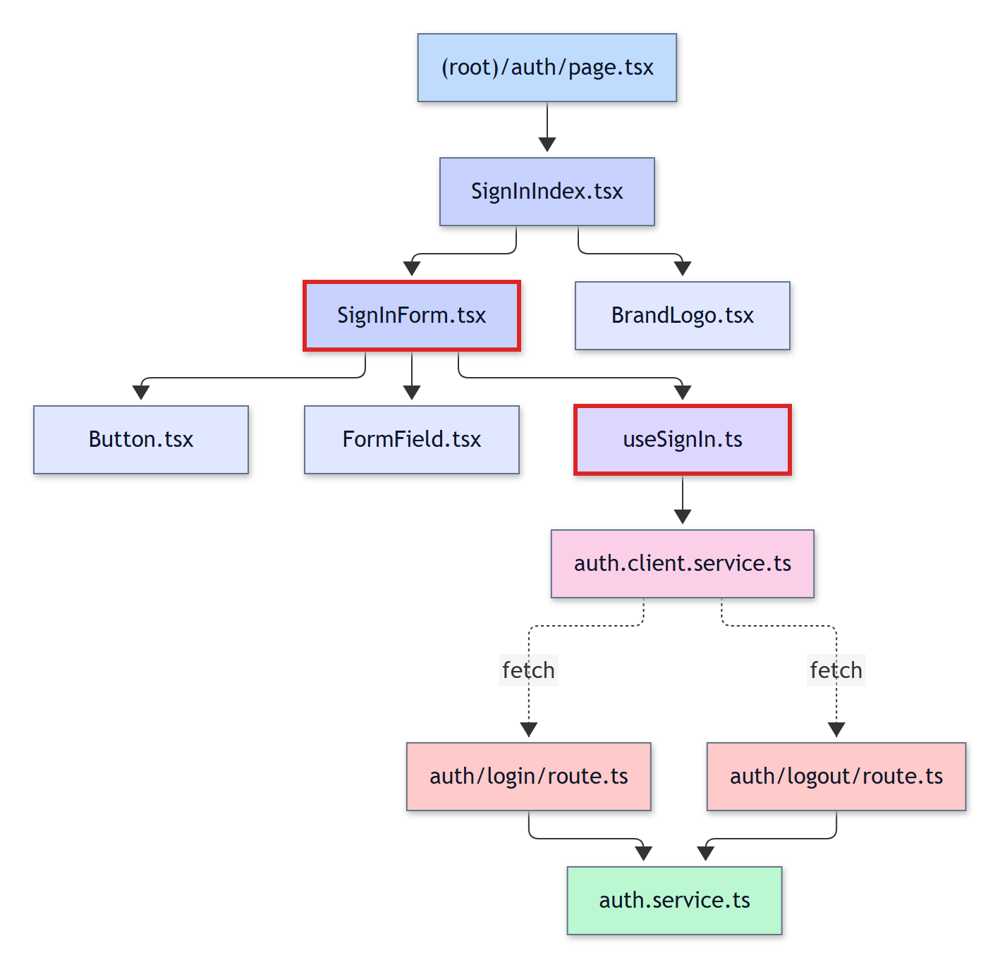](./diagrams/tree-auth.svg)

Mermaid source

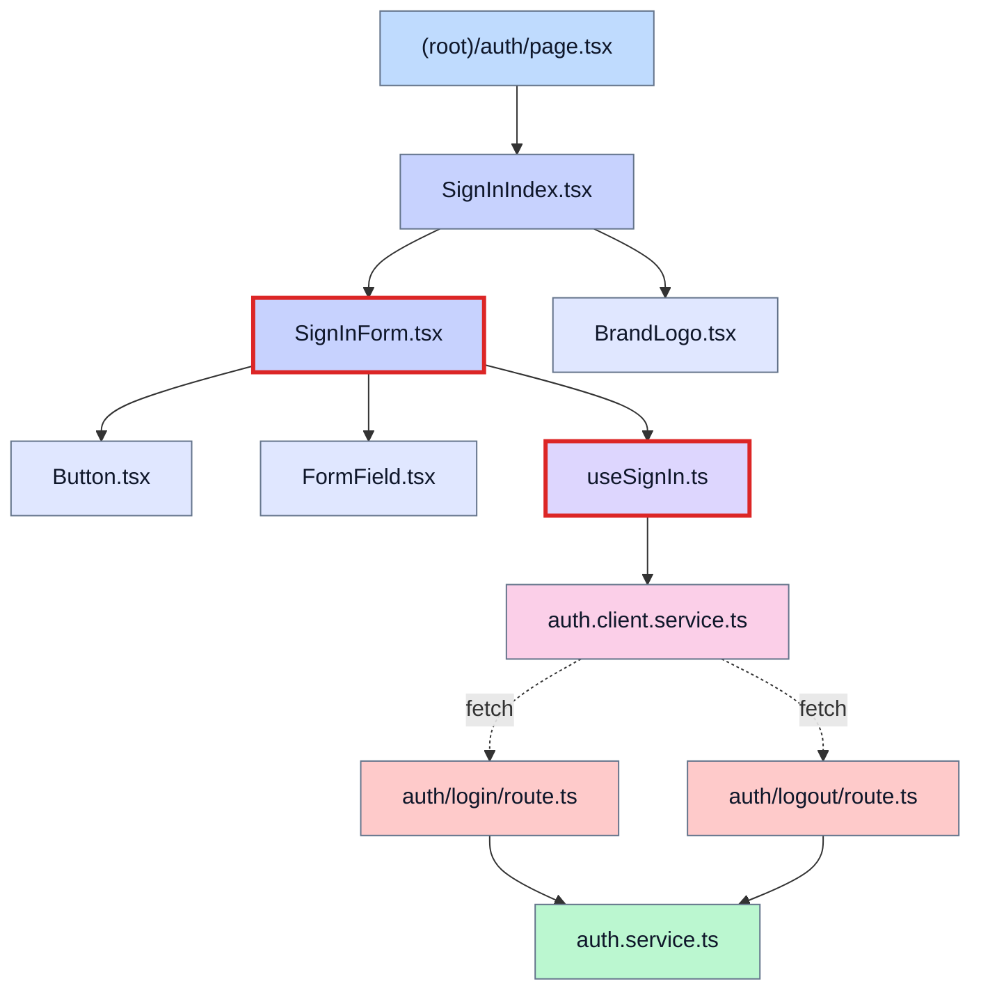

## Students list: /dashboard

Page file: `app/(root)/dashboard/page.tsx` (25 files).

[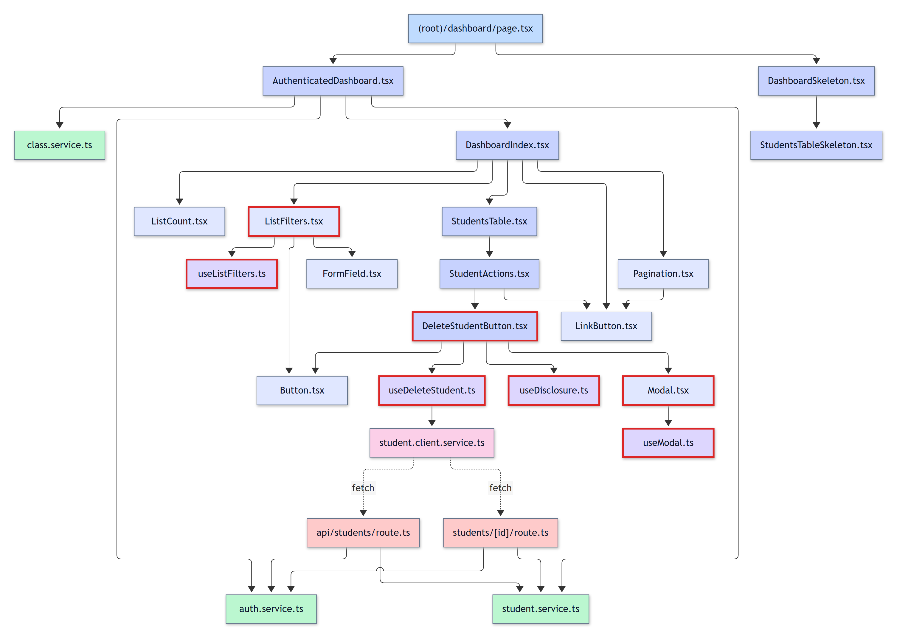](./diagrams/tree-dashboard.svg)

Mermaid source

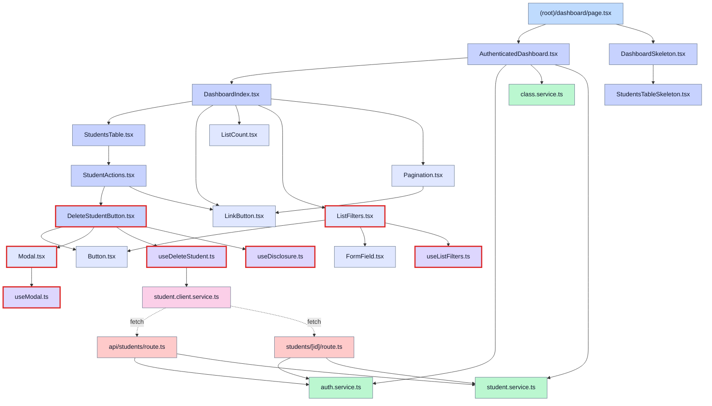

## Add a student: /dashboard/students/new

Page file: `app/(root)/dashboard/students/new/page.tsx` (18 files).

[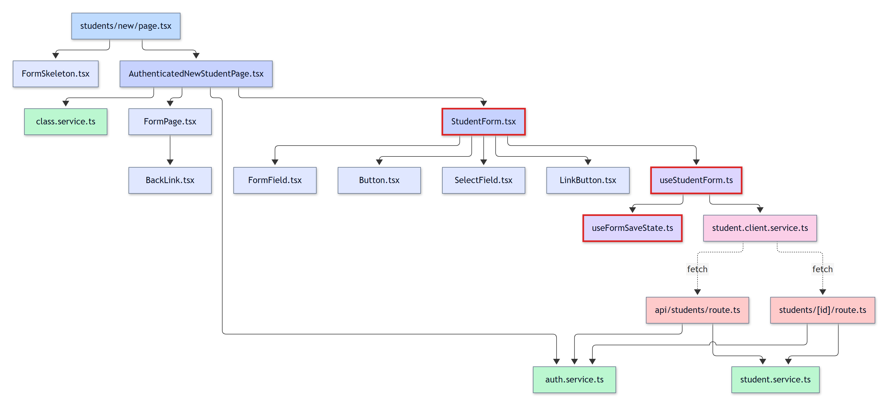](./diagrams/tree-dashboard-students-new.svg)

Mermaid source

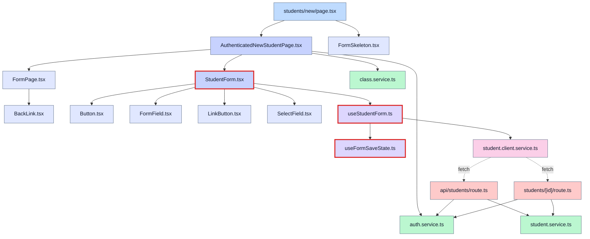

## Student page, with the student's assignments and the file and grade modal: /dashboard/students/[id]

Page file: `app/(root)/dashboard/students/[id]/page.tsx` (24 files).

[![Student page, with the student's assignments and the file and grade modal: /dashboard/students/[id]](./diagrams/tree-dashboard-students-id.png)](./diagrams/tree-dashboard-students-id.svg)

Mermaid source

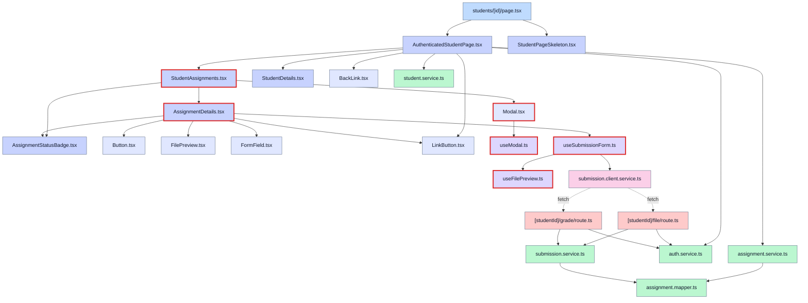

## Edit a student: /dashboard/students/[id]/edit

Page file: `app/(root)/dashboard/students/[id]/edit/page.tsx` (18 files).

[![Edit a student: /dashboard/students/[id]/edit](./diagrams/tree-dashboard-students-id-edit.png)](./diagrams/tree-dashboard-students-id-edit.svg)

Mermaid source

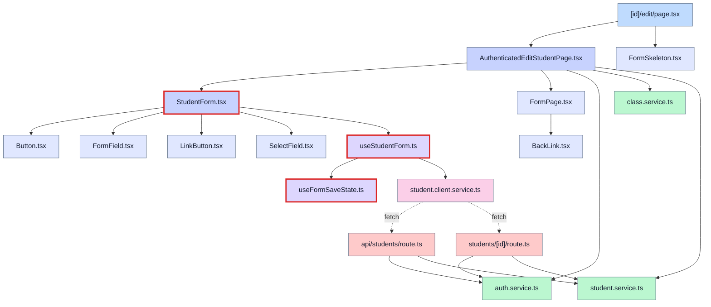

## Assignments list: /dashboard/assignments

Page file: `app/(root)/dashboard/assignments/page.tsx` (24 files).

[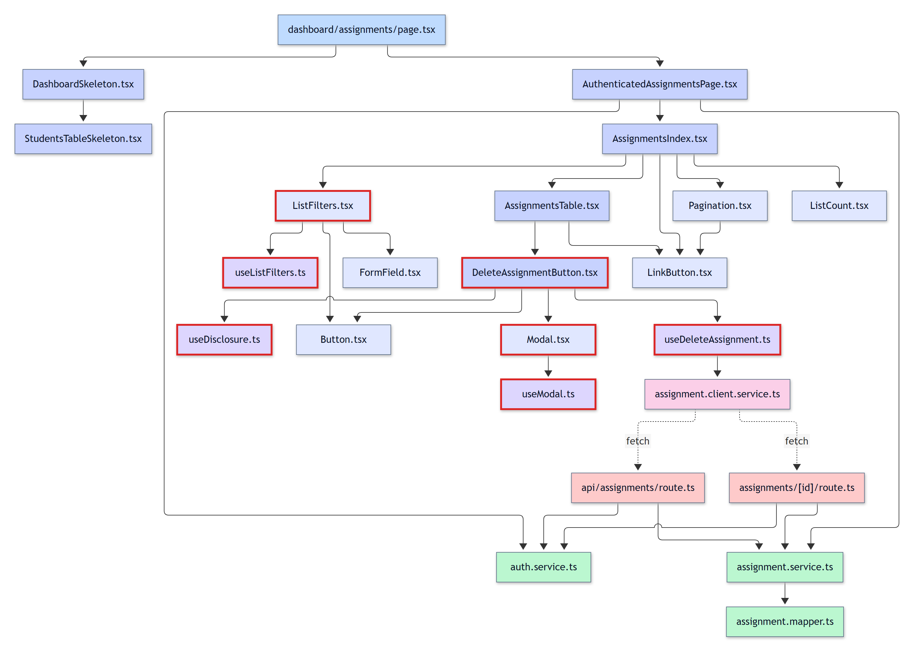](./diagrams/tree-dashboard-assignments.svg)

Mermaid source

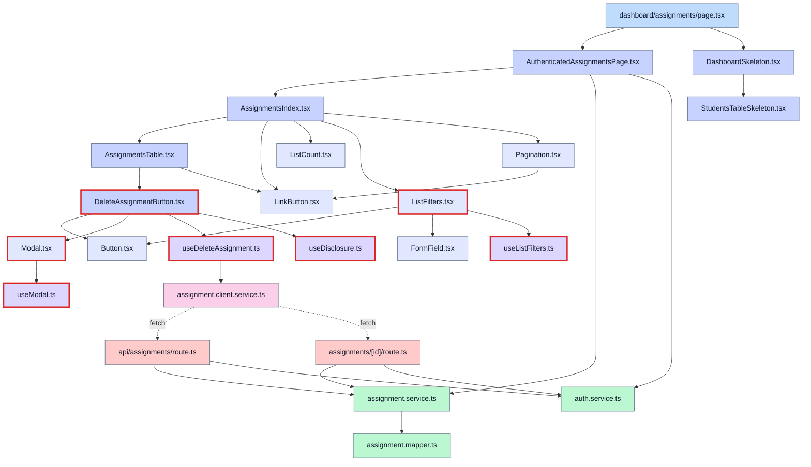

## Add an assignment: /dashboard/assignments/new

Page file: `app/(root)/dashboard/assignments/new/page.tsx` (24 files).

[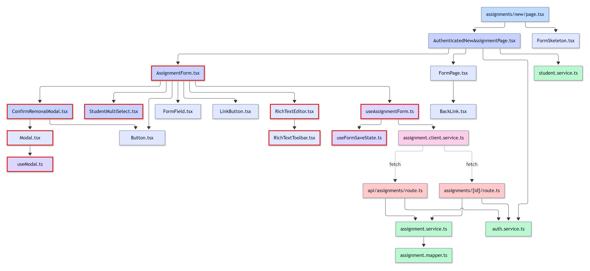](./diagrams/tree-dashboard-assignments-new.svg)

Mermaid source

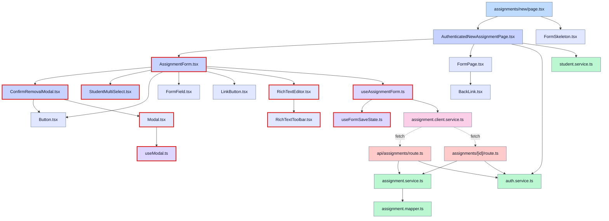

## Assignment page, with its students and the file and grade modal: /dashboard/assignments/[id]

Page file: `app/(root)/dashboard/assignments/[id]/page.tsx` (23 files).

[![Assignment page, with its students and the file and grade modal: /dashboard/assignments/[id]](./diagrams/tree-dashboard-assignments-id.png)](./diagrams/tree-dashboard-assignments-id.svg)

Mermaid source

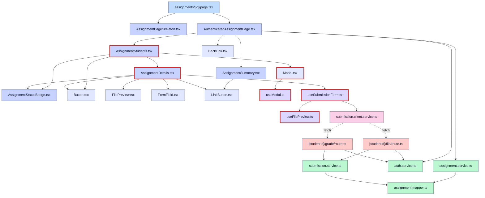

## Edit an assignment, with the removal confirmation: /dashboard/assignments/[id]/edit

Page file: `app/(root)/dashboard/assignments/[id]/edit/page.tsx` (24 files).

[![Edit an assignment, with the removal confirmation: /dashboard/assignments/[id]/edit](./diagrams/tree-dashboard-assignments-id-edit.png)](./diagrams/tree-dashboard-assignments-id-edit.svg)

Mermaid source

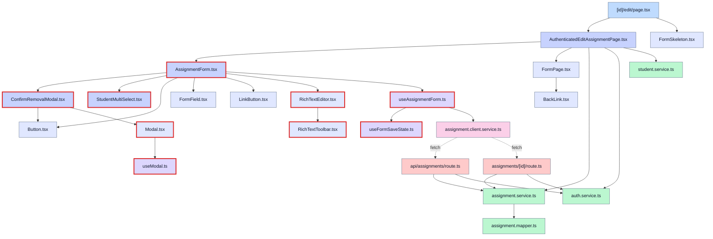

